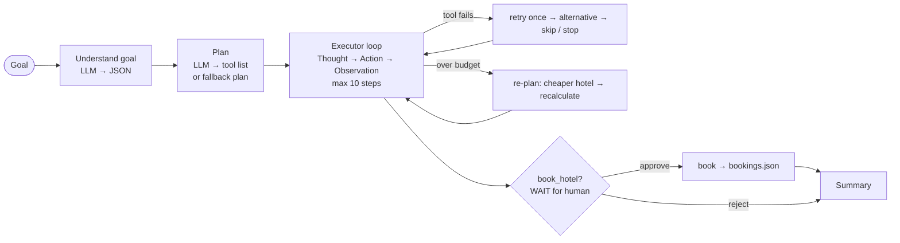

# Agentic Trip Planner: a multi-step AI agent (Task 11)

You give it one goal, for example:

> *"Plan a 3-day trip to Goa for 2 people under Rs 15,000 and book the hotel."*

The agent breaks the goal into steps and completes them one by one. It checks the weather, searches hotels, picks attractions, calculates the budget (and **re-plans** if it is over), builds a day-by-day itinerary, **pauses for human approval** before booking, and writes a final summary. It uses 6 tools, keeps all state in one JSON file per run, and recovers from failed tools.

Everything runs locally: a small local LLM (Qwen2.5-0.5B-Instruct on CPU), no API keys, free Open-Meteo weather.

Full details: **[docs/workflow.md](docs/workflow.md)** (diagrams, tool table, state fields, recovery rules, approval flow, full example trace).

## Workflow



| Step | Who | What |
|---|---|---|
| 1 | LLM | Extract city, days, guests, budget, "book?" as JSON. Each field is checked against regex rules, so a hallucinated city or a wrong number is rejected. |
| 2 | LLM | Turn the goal into a JSON list of tools. If the plan is invalid (unknown tool, missing step, wrong order), use the fixed default plan and mark it **"fallback plan"**. |
| 3–7 | tools | `get_weather` → `search_hotels` → `find_attractions` → `calculate_budget` (→ **re-plan** + recalc if over budget) → `create_itinerary` |
| 8 | human | `book_hotel` **waits for approval**: status `waiting_for_approval` + booking summary. |
| 9 | LLM | Final summary, checked against the real numbers (falls back to a template if the LLM invents numbers). |

## Tools (`tools.py`)

Each tool has a **Pydantic argument schema**; bad arguments are rejected before the tool runs.

| Tool | Purpose | Data |
|---|---|---|
| `get_weather(city, days)` | forecast for the trip days | Open-Meteo (live, free), timeout + retry |
| `search_hotels(city, max_price_per_night, guests)` | hotels under a nightly limit, best rated first | `data/hotels.json` (20 sample hotels, 10 Indian cities) |
| `find_attractions(city, top_n)` | top-rated sights | `data/attractions.json` (5 per city, sample) |
| `calculate_budget(hotel_price, nights, guests, daily_spend, budget)` | total vs. budget, over/under | – |
| `create_itinerary(city, days, attractions, weather)` | day-by-day plan; indoor sights on rainy days | – |
| `book_hotel(hotel_id, guest_name, check_in, check_out, guests)` | **important action: needs human approval** | writes `data/bookings.json` |

The weather/hotel tool code and `data/hotels.json` were adapted from my Task 10 repo ([ai-travel-assistant](https://github.com/Krishna141414/ai-travel-assistant)).

## State / history (`state.py`)

One `AgentState` per run, saved to `state/<run_id>.json` after **every** step. It holds the goal, extracted params, plan (with per-step status), current step, step history (thought, tool, args, result, status, every attempt, time), errors, approvals, a pending approval, working memory and the final answer. Because of this file, any run can be listed and replayed, and a paused run is **resumed** later by `agent.resume(run_id, "approve" | "reject")`.

## Error recovery

| Failure | What the agent does |
|---|---|
| Weather API down / timeout | retry once → cached typical-climate table → (skip, weather is optional) |
| No hotels under the limit | retry once → raise the nightly limit by 20% |
| Invalid arguments (Pydantic) | retry once with arguments rebuilt from the state |
| Unknown city | retry once → stop politely and list the supported cities |
| Total over budget | **re-plan**: cheaper hotel (or budget daily spend) → recalculate |

Every attempt is logged in the history and the `errors` list. You can trigger failures on demand: use the **Error Recovery** tab, the "Simulate failure" menu in Live mode, or `simulate: ["weather_down" | "no_hotels" | "bad_args"]` in `POST /api/run`.

## Human approval

Before `book_hotel` the agent stops with status **`waiting_for_approval`** and a summary (hotel, dates, guests, hotel cost, trip total vs budget). The state is saved, so the run can wait as long as needed.
- **Approve** → `book_hotel` runs, the booking is written to `data/bookings.json`, then the summary is written.
- **Reject** → nothing is booked; the run ends politely with status `rejected`.

## Results (`python evaluate.py` → [results.md](results.md))

6/6 test goals behaved as expected (real runs, local CPU model):

| Case | Steps | Tools used | Recoveries | Approval | Final status | Plan | Pass | Time (s) |
|---|---|---|---|---|---|---|---|---|
| Normal trip | 8 | 5 | 0 | n/a | completed | llm plan | yes | 21.4 |
| Tight budget -> re-plan | 10 | 5 | 1 | n/a | completed | llm plan | yes | 17.4 |
| Unknown city | 4 | 2 | 1 | n/a | failed | fallback plan | yes | 7.6 |
| Weather API failure | 8 | 5 | 1 | n/a | completed | llm plan | yes | 20.9 |
| User rejects booking | 10 | 6 | 0 | paused -> reject | rejected | llm plan | yes | 18.7 |
| User approves booking | 10 | 6 | 0 | paused -> approve | completed | llm plan | yes | 19.3 |

"Unknown city → failed" is the expected, polite outcome: the agent explains there is no data for that city and lists the cities it supports.

## Showcase page

A single animated "Mission Control" web app with 8 tabs: Overview, Live Agent, Tools, State & History, Error Recovery, Human Approval, Results, How it works. It also has a **Guided Tour** (Play / Pause / Next / Back, Slow / Medium / Fast; keys: Space, ← →).

- **Instant demo (default):** replays real precomputed runs from `web/demo_runs.json`, so the page works without loading the model. Rebuild them with `python build_demo.py`.
- **Run live:** when `python app.py` is running, the "Run live" toggle sends any goal to the real agent; the approval modal calls the real approve/reject endpoints.

Open it: run `python app.py`, then go to **http://127.0.0.1:5000/web/**.

## How to run

```powershell
py -3.14 -m venv .venv
.venv\Scripts\activate
pip install torch==2.15.0 --index-url https://download.pytorch.org/whl/cpu
pip install -r requirements.txt
python app.py                 # web page + API  ->  http://127.0.0.1:5000/web/
python agent.py "Plan a 2-day trip to Jaipur for 2 people under Rs 12,000"   # CLI run
python evaluate.py            # 6 test goals -> results.md + web/results.json
python build_demo.py          # refresh web/demo_runs.json for the instant demo
```

The LLM is loaded from the local Hugging Face cache (`Qwen/Qwen2.5-0.5B-Instruct`, offline mode). Download it once if it is missing.

## Project layout

```
agent.py        planner + executor loop + recovery + approval/resume
tools.py        6 tools with Pydantic schemas
state.py        AgentState (saved per run in state/)
llm.py          local Qwen2.5-0.5B wrapper (CPU, lazy-loaded)
app.py          Flask: showcase page + JSON API
evaluate.py     quick check -> results.md
build_demo.py   precompute demo runs -> web/demo_runs.json
web/            index.html, style.css, app.js, demo_runs.json, results.json
data/           hotels.json, attractions.json, weather_cache.json (sample data)
docs/workflow.md
```

## Limitations

- **Small local model.** Qwen2.5-0.5B on CPU takes about 5 s per LLM call. It extracts goals well, but its plans and summaries are not always reliable, so each one is checked by rules, with a fixed fallback plan and a template summary as backups.
- **Sample data.** The 20 hotels and 50 attractions across 10 Indian cities are made up for the demo. "Bookings" go to a local JSON file; no real booking or payment happens.
- The weather fallback is a typical-climate table, not a real forecast. Trips start one week from today. Costs use a fixed daily-spend estimate (Rs 1,000, or Rs 700 in budget mode, per person per day) and one room per booking.
- The Flask development server is meant for local use only.
