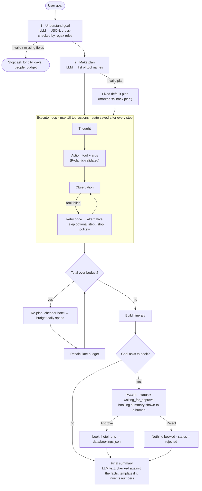
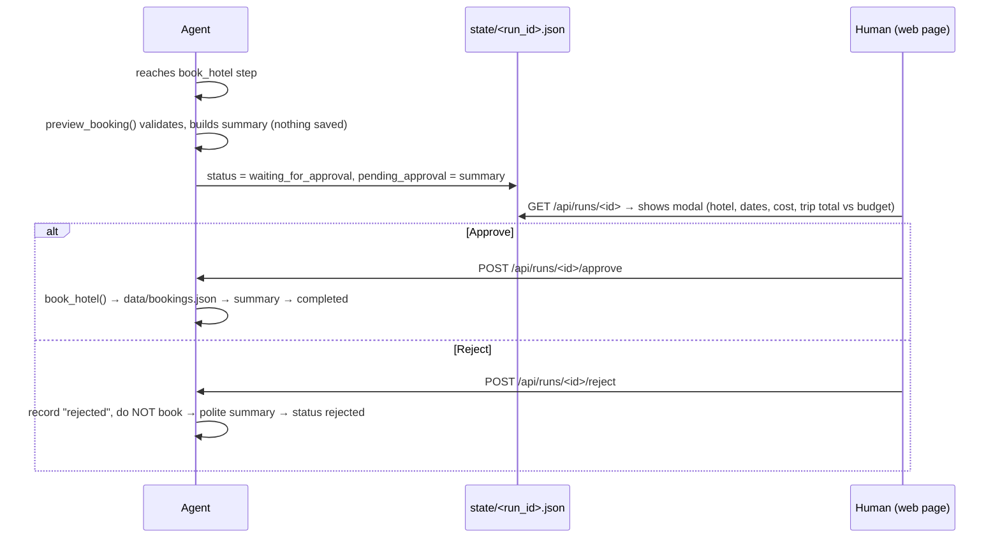

# Agent workflow and tool interactions

This document explains how the Agentic Trip Planner turns one goal into a finished trip plan: the steps, the tools, the state object, error recovery, the approval flow, and one full run trace.

## 1. Workflow

Default plan (used when the LLM plan is invalid):
`get_weather → search_hotels → find_attractions → calculate_budget → create_itinerary → (book_hotel) → write_summary`.

The LLM plan is accepted only if it uses known tools, contains `search_hotels`, `find_attractions`, `calculate_budget` and `create_itinerary`, and respects the dependencies (hotel before budget; weather and attractions before itinerary). `book_hotel` is added only when the goal asks for a booking, and always last.

## 2. Tools (`tools.py`)

Every tool has a Pydantic argument schema. Arguments are validated before the tool runs. Failures raise `ToolError(kind=...)`, which tells the agent which recovery to use.

| Tool | Purpose | Args | Output | Can fail how → what the agent does |
|---|---|---|---|---|
| `get_weather` | Live forecast for the trip days (Open-Meteo, free, no key). Our 10 cities use fixed coordinates. | `city, days, start_date?` | daily min/max °C, rain %, condition, source | API down/timeout (`transient`) or unknown city (`not_found`) → retry once → cached typical-climate table → skip (optional step) |
| `search_hotels` | Hotels in the city under a nightly price that fit the guests (`data/hotels.json`, sample data). Best rated first. | `city, max_price_per_night, guests` | matching hotels | nothing under the limit (`no_match`) → retry → raise limit by 20%; unknown city (`not_found`) → retry → stop politely and list supported cities; invalid args → retry with args rebuilt from state |
| `find_attractions` | Top-rated sights (`data/attractions.json`, sample data). | `city, top_n` | attractions with rating, indoor flag, fee | unknown city → retry → skip (optional) |
| `calculate_budget` | Hotel × nights + daily spend × guests × days, against the budget. | `hotel_price, nights, guests, daily_spend, budget` | total, difference, `under`/`over`, formula | invalid args → retry; **over budget → re-plan** |
| `create_itinerary` | Day-by-day plan, 2 sights per day; on a rainy day (≥ 60% rain) indoor sights go first. | `city, days, attractions, weather` | days with Morning/Afternoon/Evening slots | invalid args → retry → stop |
| `book_hotel` | **Important action.** Books the hotel and appends it to `data/bookings.json`. | `hotel_id, guest_name, check_in, check_out, guests` | booking id + details | needs human approval first; rules (hotel exists, future dates, capacity) are checked again when it runs |

## 3. State object (`state.py`)

One `AgentState` per run, saved to `state/<run_id>.json` after every step. That lets the web page replay any run, and lets a paused run be **resumed after approval**, even after a server restart.

| Field | Meaning |
|---|---|
| `run_id`, `goal`, `simulate` | identity, the user's goal, simulated failures (if any) |
| `status` | `running` · `waiting_for_approval` · `completed` · `rejected` · `failed` |
| `params`, `params_source` | city, days, guests, budget, book?, guest_name; source = `llm`, `llm + rules` or `rules (fallback)` |
| `plan`, `plan_source` | list of `PlanStep(id, tool, label, status, added_by_replan)`; source = `llm plan` or `fallback plan` |
| `current_step` | index into `plan` (where to resume) |
| `history` | list of `StepRecord(plan_id, thought, tool, args, result, status, attempts[], recovery, time, duration_ms)` |
| `errors` | every failed attempt: step, tool, attempt kind, error, time |
| `approvals`, `pending_approval` | human decisions; the booking summary while paused |
| `memory` | working memory: weather, hotels, chosen_hotel, attractions, budget, itinerary, booking, dates |
| `final_answer` | the summary shown to the user |

## 4. Error-recovery rules (`agent.call_tool`)

1. **Call** the tool with its validated args.
2. **Retry once.** Use the same args, or args rebuilt from the state if the first failure was a Pydantic validation error.
3. **Alternative.** Each tool defines its own:
   - `get_weather`: use the cached typical-climate table.
   - `search_hotels`: raise the nightly limit by 20% (only for `no_match`).
4. **Skip or stop.** Optional steps (`get_weather`, `find_attractions`) are skipped and the plan continues. If a required step fails, the run stops with status `failed` and a polite message.
5. **Over budget → re-plan.** The agent inserts two new plan steps: `re_plan` (switch to a cheaper hotel from the search results or, if none, to budget daily spend of Rs 700/person/day) and a second `calculate_budget`. If it is still over budget with no options left, the agent continues with a warning in the summary.
6. **Every attempt is logged** in `history[].attempts` and `errors`. The step status becomes `recovered`, `skipped` or `failed`.
7. **Step limit.** At most 10 tool actions per run (LLM steps are not counted).

**Simulating failures (for demos).** Pass `simulate` to `/api/run`, or use the Error Recovery tab:
- `weather_down`: the forecast URL points at a dead address.
- `no_hotels`: the first hotel query and its retry come back empty.
- `bad_args`: the hotel search gets broken arguments (`guests="two"`, negative price).

## 5. Human approval flow

## 6. Full example run (real output)

Goal: **"Plan a 3-day trip to Goa for 2 people under Rs 15,000 and book the hotel."** (Trips start one week from the run date.)

| # | Thought | Action | Observation | Status |
|---|---|---|---|---|
| 1 | Read the goal and extract city, days, guests and budget as JSON. | `llm` | city Goa, days 3, guests 2, budget 15000, book true (source: llm) | done |
| 2 | Break the goal into tool steps (JSON). If the plan is invalid, use the fixed default plan. | `llm` | get_weather → search_hotels → find_attractions → calculate_budget → create_itinerary → book_hotel → write_summary (**llm plan**) | done |
| 3 | I need the weather in Goa for the 3 trip days so the itinerary can avoid rain. | `get_weather(city=Goa, days=3, start_date=2026-11-10)` | Open-Meteo (live): clear sky, 20–35 °C all 3 days | done |
| 4 | Hotel gets at most 70% of the budget: Rs 15,000 × 0.7 / 2 nights = Rs 5,250/night. | `search_hotels(city=Goa, max_price_per_night=5250, guests=2)` | 2 hotels fit, chosen: Palm Shore Resort (★4.4) | done |
| 5 | Pick the top-rated sights in Goa - about 2 per day for 3 days. | `find_attractions(city=Goa, top_n=6)` | Basilica of Bom Jesus, Baga & Calangute Beach, Fort Aguada, Fontainhas, Goa Science Centre | done |
| 6 | Check the total: Palm Shore Resort (Rs 5,200/night) for 2 nights + Rs 1000/person/day. | `calculate_budget(5200, 2, 2, 1000, 15000)` | total Rs 16,400 → **over by Rs 1,400** | done |
| 7 | Over budget by Rs 1,400. Re-plan: swap Palm Shore Resort for the cheaper Sunset Shack Stay. | `re_plan` | Palm Shore Resort (Rs 5,200) → Sunset Shack Stay (Rs 2,800) | done |
| 8 | Check the total: Sunset Shack Stay (Rs 2,800/night) for 2 nights … | `calculate_budget(2800, 2, 2, 1000, 15000)` | total Rs 11,600 → under by Rs 3,400 | done |
| 9 | Build a 3-day plan for Goa, using the forecast to move indoor sights to rainy days. | `create_itinerary(city=Goa, days=3, attractions=[5], weather=[3])` | Day 1: Basilica, Baga Beach · Day 2: Fort Aguada, Fontainhas · Day 3: Science Centre, free time | done |
| 10 | Booking spends the user's money, so I must not do it alone. Pausing for human approval. | `book_hotel(H02, …)` (not executed) | **PAUSED**: "Book Sunset Shack Stay for 2 night(s), Rs 5,600?" | waiting |
| 11 | The human approved - booking the hotel now. | `book_hotel(hotel_id=H02, guest_name=Traveller, check_in=2026-11-10, check_out=2026-11-12, guests=2)` | booked BK1006 (Sunset Shack Stay, Rs 5,600) | done |
| 12 | Everything is done. Write a short summary (checked against the facts). | `llm` | the LLM text used numbers that are not in the facts, so the template summary was used | done |

**Final answer** (status `completed`):
> Trip: 3 days in Goa for 2 people, from 2026-11-10 to 2026-11-12. Hotel: Sunset Shack Stay in Anjuna, Rs 2,800 per night, rating 4.1. Estimated total: Rs 11,600 of the Rs 15,000 budget (under budget). Highlights: Basilica of Bom Jesus, Baga & Calangute Beach, Fort Aguada. Weather: clear sky, 21 to 34 C. Booking confirmed: BK1006.

If the human had clicked **Reject** at step 10, step 11 would be recorded as `rejected`, nothing would be written to `bookings.json`, and the run would end with status `rejected` and a polite summary.

## 7. HTTP API (`app.py`)

| Method | Path | What it does |
|---|---|---|
| GET | `/web/` | showcase page |
| POST | `/api/run` `{goal, simulate[]}` | starts a run in a background thread → `{run_id}` |
| GET | `/api/runs`, `/api/runs/<id>` | list saved runs / full `AgentState` (the page polls this) |
| POST | `/api/runs/<id>/approve` · `/reject` | human decision → `agent.resume()` |
| GET | `/api/approvals` | runs waiting for approval |
| POST | `/api/tools/<name>` `{args}` | run one tool directly (`book_hotel` only previews) |
| GET | `/api/health` | backend check (the page shows "Run live" only if this answers) |
